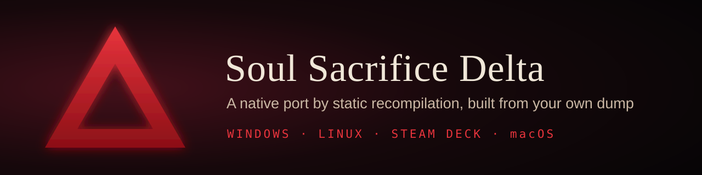
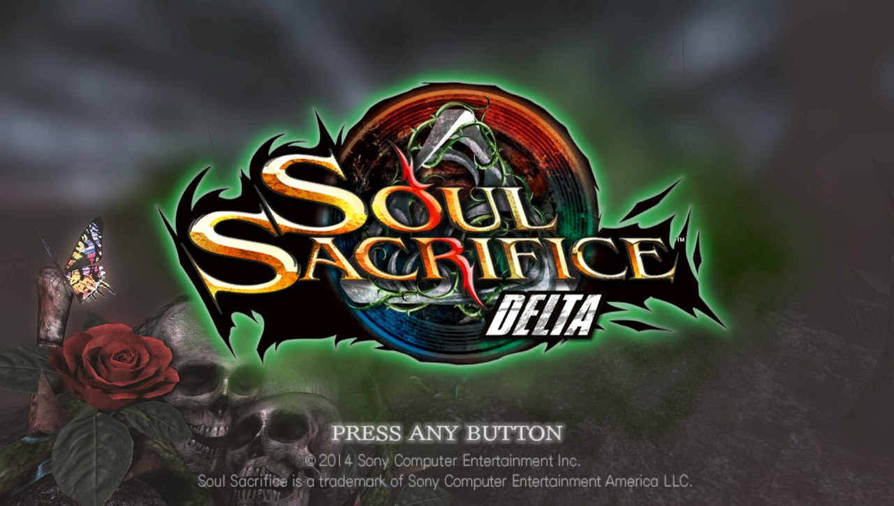
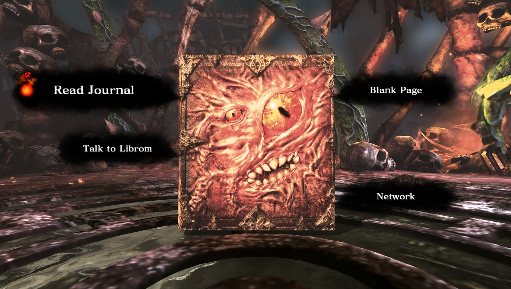
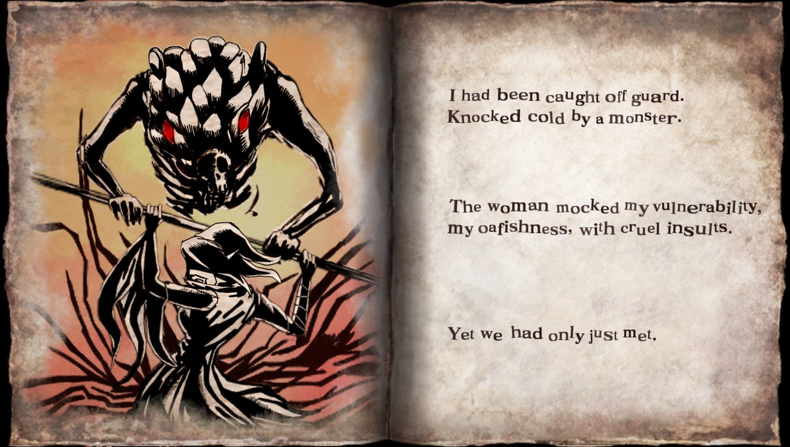
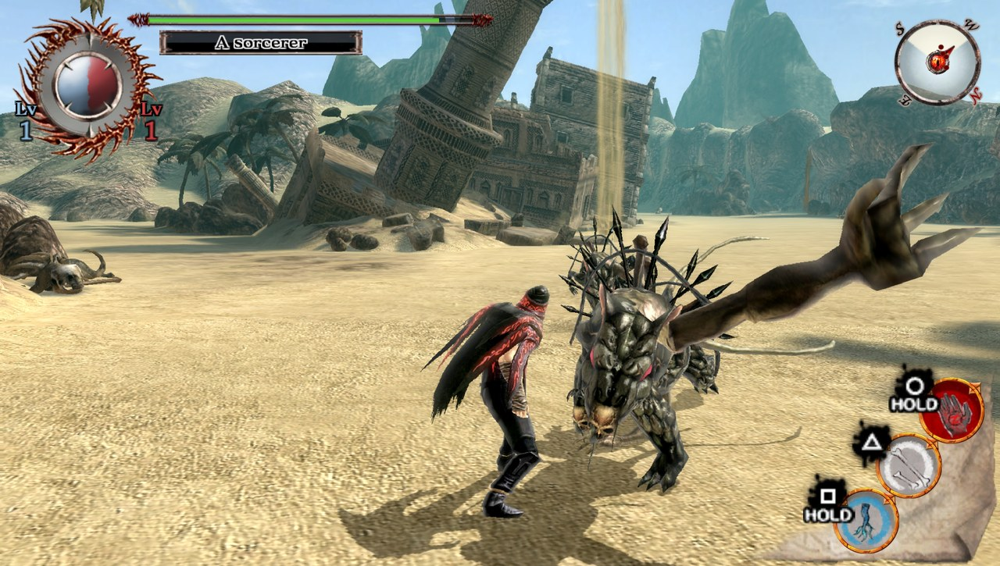
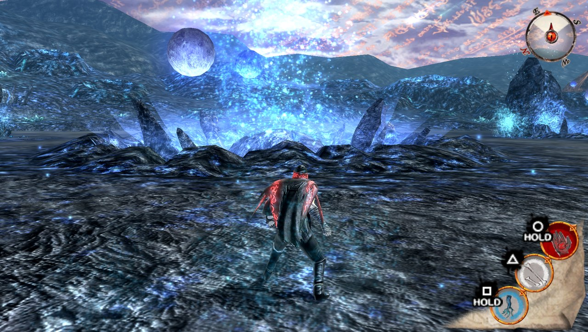
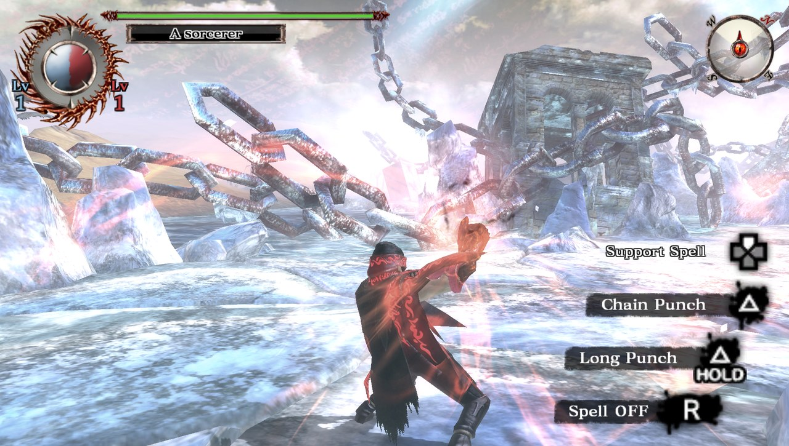
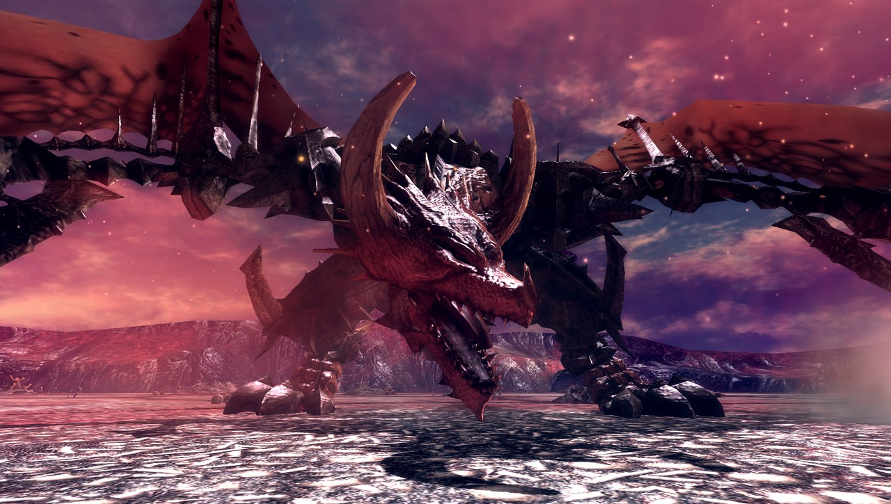
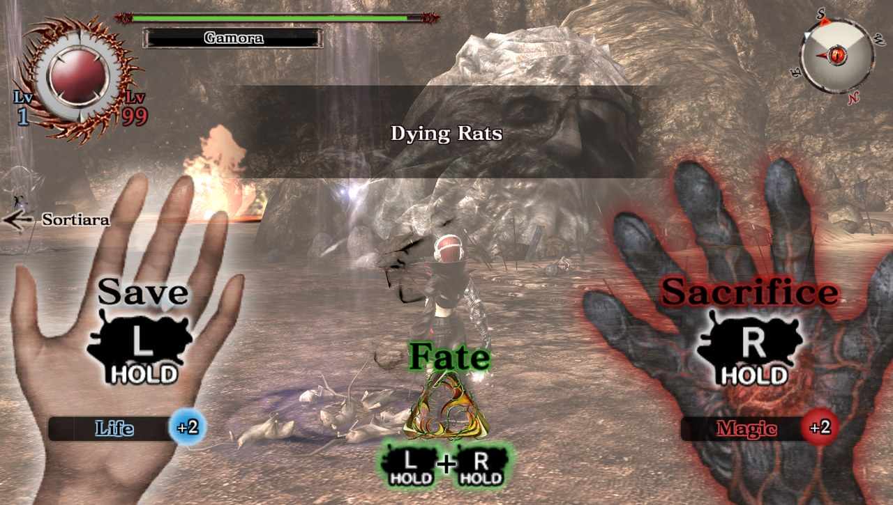

**A native port of Soul Sacrifice Delta (PS Vita) to Windows, Linux and the Steam Deck, macOS, and Android, by static recompilation.**

<a href="https://recomplauncher.com/game/ss-delta"><picture><source media="(prefers-color-scheme: dark)" srcset="https://recomplauncher.com/assets/press/launcher/badge-light.svg"></picture></a>

**[Download the latest release](https://github.com/vita-recomps/ss-delta/releases/latest)** ·
[Installation guide](docs/INSTALLING.md) ·
[Changelog](CHANGELOG.md) ·
[Build from source](docs/BUILDING.md) ·
[Compatibility](docs/06-compatibility.md) ·
[Report an issue](https://github.com/vita-recomps/ss-delta/issues)

## About

ss-delta runs **Soul Sacrifice Delta** (PS Vita, US PCSA00152 or EU
PCSF00532, v1.30) natively. The game's code, and the firmware modules it
loads, are recompiled ahead of time to C++ and run natively inside a fork of
Vita3K, which supplies the rest of the console.

> This repository and its releases contain *no* game data, *no* firmware and
> *no* code derived from the game, apart from the README's
> [screenshots](#screenshots). You bring your own dump; everything
> game-derived is generated on your computer from it. See
> [D2](docs/decisions.md) and [D23](docs/decisions.md).

## Status

The whole game plays on native code, without a JIT, from the opening to the
ending: every quest map and the story up to the final battle render
correctly on AMD and NVIDIA GPUs, the final battle has been won and its
ending plays correctly (on an AMD GPU), the add-ons are unlocked, and Ad Hoc
Play works between copies on one PC and across a LAN
([compatibility](docs/06-compatibility.md)).

Since 0.4.0 it runs on four platforms, each natively at 60 fps:

* **Windows** 10 or 11, x64;
* **Linux** x64, the **Steam Deck** among them (desktop mode to set up,
  then Game Mode to play; [07-linux](docs/07-linux.md));
* **macOS** 13.3 or newer on **Apple Silicon** (M1 and later, tested on an
  M5; [08-macos](docs/08-macos.md));
* **Android** 9 or newer on 64-bit ARM with Vulkan, made for Snapdragon
  handhelds (tested on an AYN Thor): the app builds the game on the device
  itself from your dump, no PC needed ([09-android](docs/09-android.md)).
  On a phone without a gamepad it has on-screen controls.

They play Ad Hoc Play together over a LAN: a Windows PC, a Steam Deck and
a Mac have shared one room and played a quest, with any of them as host.

## Features

Compared with running the game in Vita3K:

* **Native code.** The game's code, and the firmware modules it loads, are
  recompiled ahead of time to C++ and run natively; the build ships without
  the JIT. Each module is checked against the game in memory before its
  native code runs.
* **60 fps.** The game runs at 60 fps by default and keeps its speed:
  ss-delta changes its frame pacing (data in memory) and fixes the two
  places in the game's code that assumed 30 (Blitz offerings, a race on
  loading screens; [D16](docs/decisions.md), [D30](docs/decisions.md)).
  `frame_rate = 30` gives the Vita's rate.
* **Full-resolution 3D.** On a Vita the game draws its 3D at 720×408 and
  stretches it. ss-delta uses the game's own 960×544 mode, times the
  resolution multiplier: 1920×1088 at scale 2 ([D13](docs/decisions.md)).
* **Rendering fixes** for bugs the game shows in Vita3K, among them the
  white floors on NVIDIA GPUs (in upstream Vita3K and Vita3K-Plus too) and
  a "ghost" of the bloom trailing moving objects.
* **Ad Hoc Play without a Vita.** Up to four copies of the game play
  together: on one PC, each with its own saves and gamepad, or across a LAN,
  Windows, Linux and macOS mixed ([D15](docs/decisions.md)).
* **The add-ons unlocked.** Their content is in the game since update
  1.30, and PSN, which recorded the purchases, is closed
  ([D14](docs/decisions.md)).
* **An in-game settings menu** (F1, or Select held on a gamepad) over the
  paused game, and a commented `ss-delta.ini`.
* **The game's languages:** English, French, Spanish and Portuguese (Brazil)
  in the US game, English, French, Spanish, German and Italian in the EU
  one (Language in the settings menu).
* **Japanese voices:** the Japanese Voice-over Pack add-on, and rePatch
  mods such as the Undub patch, installed beside the game.
* **Cheats** on the settings menu's Cheats page: Infinite health,
  Unlimited and Lasting offerings, One-hit kills, Max Lacrima and Max
  levels.
* **Xbox button labels** in the game's prompts, tutorial pictures and
  text, as an option (Button prompts in the settings menu; or as the
  connected gamepad): A, B, X, Y, LB, RB, Menu and View, after your gamepad
  bindings.
* **Intro logos skipped** as an option (Skip intro logos in the settings
  menu): the game opens on its title screen.
* **Touch on keys and buttons:** the Black Rite icon on F and the left
  trigger; the mouse is the touchscreens.
* **Mouse camera** on the PC: Tab or a middle click captures the cursor,
  and the mouse turns the camera (Sensitivity and Invert vertical in the
  settings menu); Tab, a middle click or Esc gives the touchscreen back.
* **Vita saves** imported and exported (`--import-save`, `--export-save`).
* **One program** per platform (`ss-delta.exe`, `ss-delta.x86_64`, the
  macOS app), without Vita3K's interface and offline, which builds itself
  from your own dump on its first start, in its own folder.

## Download and play

Download the archive for your system from the
**[latest release](https://github.com/vita-recomps/ss-delta/releases/latest)**.
It unpacks to the game's folder, `ss-delta`, with one program to start:

| System | Download | Start |
|---|---|---|
| Windows 10/11, x64 | `ss-delta-<version>-windows.zip` | `ss-delta.exe` |
| Linux x64, Steam Deck | `ss-delta-<version>-linux.tar.gz` | `ss-delta.x86_64` |
| macOS 13.3+, Apple Silicon | `ss-delta-<version>-macos.tar.gz` | `Soul Sacrifice Delta.app` |
| Android 9+, arm64 | `ss-delta-<version>-android.apk` | **ss-delta** (install the APK) |

The first start builds the game from your own dump of it (at update 1.30):
its importer asks for the dump, downloads the PS Vita firmware from Sony and
a compiler, and compiles the game's code on your computer, in a few
minutes. From then on the program goes straight to the game. Everything
stays in that folder ([D22](docs/decisions.md)), and the command line covers
everything (`--help`). On Android the app's setup screen does the same on
the device: you pick the dump, it downloads the firmware and builds the
game's code there (about 15 minutes on a Snapdragon 8 Gen 2; [D27](docs/decisions.md)).

The **[installation guide](docs/INSTALLING.md)** has the details for each
system: what dumps work, the Steam Deck's Game Mode, macOS's Gatekeeper,
saves, Ad Hoc Play, files, command-line options and updating. To build it
yourself, see **[BUILDING](docs/BUILDING.md)**.

## Documentation

| Doc | Contents |
|---|---|
| [CHANGELOG](CHANGELOG.md) | what changed in each release, with the issues that asked for it |
| [INSTALLING](docs/INSTALLING.md) | for players: requirements, each system, the first start, saves, Ad Hoc Play, files, command line |
| [GALLERY](docs/GALLERY.md) | screenshots of the raiments and hoods ss-delta adds, and of the original game's two raiments (a mod) |
| [ORIGINAL-CONTENT](docs/ORIGINAL-CONTENT.md) | what the original Soul Sacrifice has that Delta lacks, and what ss-delta does about it: the Spirits' offerings, the collaboration raiments |
| [BUILDING](docs/BUILDING.md) | building from source, installing a game into a build, making a release, the toolchain and tools |
| [01-research](docs/01-research.md) | prior work, the dump's structure, measurements of the 1.30 eboot, Vita3K as donor, approach options |
| [02-baseline](docs/02-baseline.md) | how the game behaves in Vita3K today, and how to re-run the baseline |
| [03-plan](docs/03-plan.md) | phases, exit criteria, risks |
| [04-inventory](docs/04-inventory.md) | the code inventory: functions, jump tables, indirect branches, exceptions, frame pacing and render-target sites |
| [05-recompiler](docs/05-recompiler.md) | the recompiler and its runtime in the fork: generated code, coverage, tests, build, `SSD_AOT` and differential mode |
| [06-compatibility](docs/06-compatibility.md) | what works in each part of the game, and how it was checked |
| [07-linux](docs/07-linux.md) | Linux and the Steam Deck: what the code needs, the setup, packaging |
| [08-macos](docs/08-macos.md) | macOS on Apple Silicon: what the code needs, MoltenVK and memory mapping, signing |
| [09-android](docs/09-android.md) | Android on the AYN Thor: what the code needs, the setup on the device |
| [10-ios](docs/10-ios.md) | iOS and iPadOS (planned): no JIT needed, the modules in a sideloaded IPA, memory limits, developing on the Mac |
| [decisions](docs/decisions.md) | decision log |
| [hashes](docs/hashes.md) | input hashes |

## Licence

MIT ([LICENSE](LICENSE)), except `patches/vita3k/`, which are changes to
Vita3K and, like it, under the GNU GPL version 2 or later. The Vita3K fork
(`third_party/vita3k`) is GPL-2.0-or-later.

## Screenshots

Taken from the port at 2× resolution (1920×1088, scaled down here), on
native code.

| | |
|---|---|
|  |  |
| The title screen | Librom, the talking book |
|  |  |
| A page of the journal | A fight in the desert ruins |
|  |  |
| A moonlit field of blue crystals | A spell among ice and chains |
|  |  |
| The dragon Dionaea lands | Save or sacrifice |

The raiments and hoods ss-delta adds, female and male, are in the
**[gallery](docs/GALLERY.md)**.
